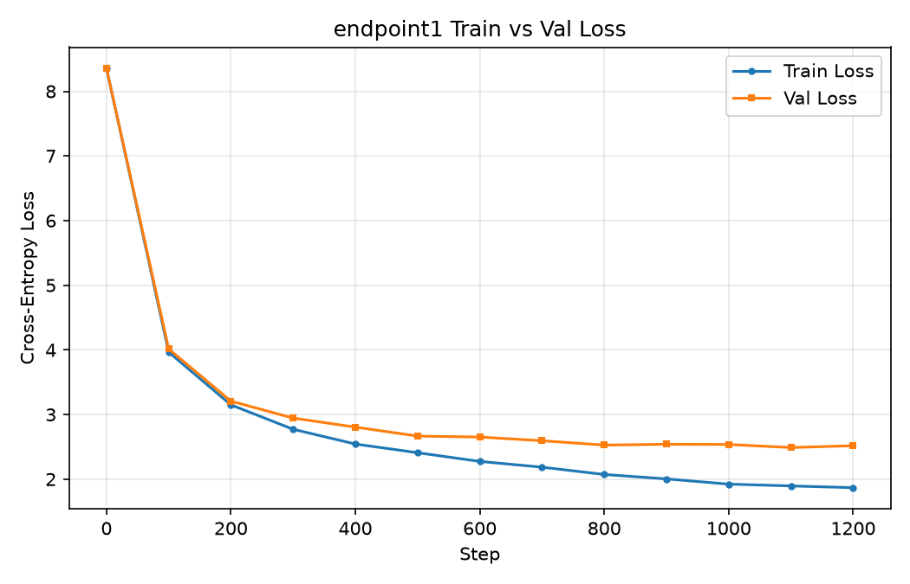
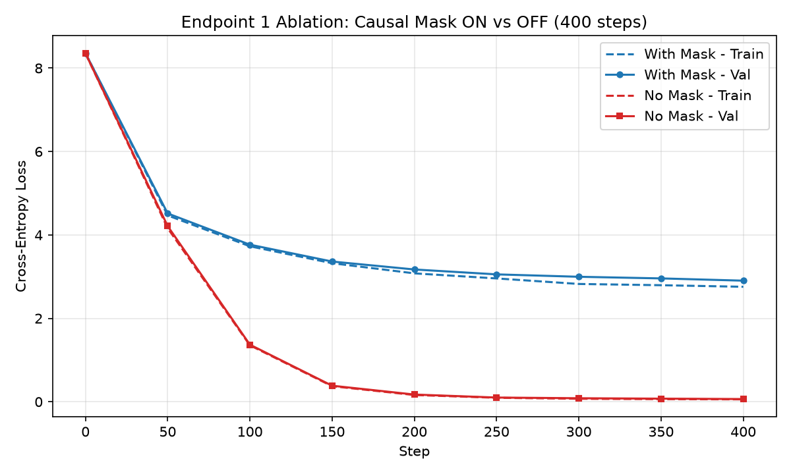
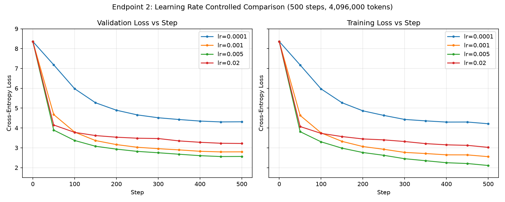
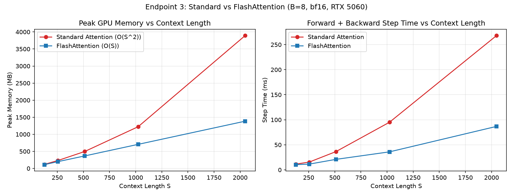
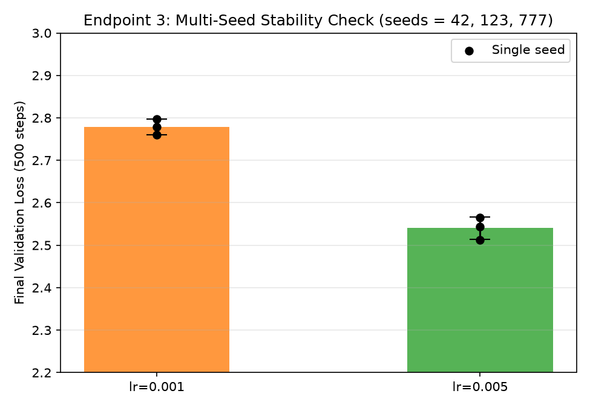

# NanoLLM: From-Scratch Modern Transformer & Controlled Experiments

从零实现的轻量级现代 Decoder-Only 自回归语言模型（PyTorch），覆盖 **BPE 分词器 → Pre-Norm Transformer（RMSNorm / SwiGLU / RoPE / Causal MHA & FlashAttention）→ AdamW + 余弦退火 → 训练/验证/生成 → 对照实验与 GPU 系统实测**。

---

## 1. 模型架构与关键 Tensor Shape

* **核心组件**（`assignment1-basics/cs336_basics/`）：
  * 分词：`bpe.py`、`tokenizer.py`（字节级 BPE 训练与编解码）
  * 模型：`nn.py`、`model.py`（无偏置 `Linear`、`Embedding`、`RMSNorm`、`SwiGLU`、`RoPE`、`MultiHeadSelfAttention` 支持标准版与 FlashAttention 切换、Pre-Norm `TransformerLM`）
  * 优化与数据：`optim.py`（数值稳定 `cross_entropy`、`AdamW`、`get_lr_cosine_schedule`、`clip_gradient`）、`data.py`（`get_batch` 与 Checkpoint 存取）
  * 测试校验：`pytest` 全量单元测试 **`46 passed, 2 skipped`**（2 项跳过为 Linux 专属 `rlimit` 测试）。
* **默认实验模型配置**：`vocab_size=4096, context_length=256, d_model=256, num_layers=4, num_heads=4, d_ff=768`，总参数量 **5,507,328（5.51M）**。
* **主干数据流与 Shape 变化**：
  1. `get_batch`：一维词元流 `(N,)` → 输入 `x: (B, S)`，目标 `y: (B, S)`（整体右移 1 位）
  2. `token_embeddings`：`x (B, S)` → `(B, S, D)`
  3. 4 × `TransformerBlock`：
     * `RMSNorm` → `Q, K, V` 线性投影并拆头 `(B, H, S, d_k)` → 对 `Q, K` 施加 `RoPE` → 因果点积注意力权重 `(B, H, S, S)` → 合并回 `(B, S, D)` + `output_proj` → 残差 `+ x`
     * `RMSNorm` → `SwiGLU` `(B, S, D) -> (B, S, d_ff) -> (B, S, D)` → 残差 `+ x`
  4. `ln_final` + `lm_head`：`(B, S, D)` → `logits (B, S, V)`
  5. `cross_entropy(logits, y)` → 标量 `loss` → `backward()` + `clip_gradient` + `AdamW.step()`

### 环境与一键复现命令
* 硬件：单卡 `NVIDIA GeForce RTX 5060 Laptop GPU`（PyTorch + CUDA）
* 数据：基于仓库内置 `tinystories_sample_5M.txt`（6,458 篇故事），按 `<|endoftext|>` 整篇故事 **90% / 10% 零重叠隔离**，仅在训练集上训练 BPE 词表（`vocab_size=4096`），编码得训练集 **1,178,567 tokens**、验证集 **132,030 tokens**。

```powershell
cd assignment1-basics
.\.venv\Scripts\pytest.exe tests -q                              # 1. 运行全量单元测试
.\.venv\Scripts\python.exe -m cs336_basics.prepare_data          # 2. 故事级切分与 BPE 编码
.\.venv\Scripts\python.exe -m cs336_basics.train --mode overfit  # 3. 单 Batch 过拟合自检
.\.venv\Scripts\python.exe -m cs336_basics.train --mode train    # 4. 1200 步基线训练
.\.venv\Scripts\python.exe -m cs336_basics.generate              # 5. 多阶段文本生成对比
.\.venv\Scripts\python.exe -m cs336_basics.run_ablation          # 6. 因果掩码消融实验
.\.venv\Scripts\python.exe -m cs336_basics.run_lr_sweep          # 7. 学习率单变量对照
.\.venv\Scripts\python.exe -m cs336_basics.benchmark_attention   # 8. Attention 显存与耗时实测
.\.venv\Scripts\python.exe -m cs336_basics.run_seed_check        # 9. 多随机种子稳定性复核
```

---

## 2. 实验一：基线训练、生成演进与因果掩码消融

### 2.1 单 Batch 自检与 1200 步基线训练
* **初始误差与闭环校验**：理论随机初始化 Loss `ln(4096) = 8.3178`，实测第 0 步 **`8.3529`**；固定单个 Batch 连训 200 步后 Loss 降至 **`0.0009`**，验证前向、反向与优化器链路无误。
* **完整训练基准**（`B=32, S=256, max_lr=1e-3, 1200 steps`，总耗时 `139.0s`，峰值显存 `1674.3 MB`）：`Train Loss` 从 `8.3580` 降至 `1.8684`，`Val Loss` 从 `8.3581` 降至 `2.5174`（800 步后在 5MB 小语料上开始出现轻微过拟合）。



* **同一开头 `"Once upon a time"` 的三阶段生成演进**（`temperature=0.8`）：
  * **Step 0（未训练）**：`"Once upon a time are e ruined delicatenot envOkayies jun intR claych..."`（纯乱码）
  * **Step 600（中期）**：`"Once upon a time, there was a little boy named Tim. Tim loved to play with his friends. ... They all became best friends and lived happily ever after.<|endoftext|>"`（已形成完整故事并学会输出结束符）
  * **Step 1200（末期）**：`"Once upon a time, there was a little boy named Tim. ... 'Hi Sam! Hi Tim! I like your friend!' said Tim..."`（开始生成带引号的人物对话）

### 2.2 关键代码修改对照：关闭因果掩码（`causal_mask = False`）
* **设置**：锁死数据、5.51M 模型、`seed=42`、`max_lr=1e-3`、400 步，唯一改变 `use_causal_mask`（`True` vs `False`）。
* **结果对比**：

| 组别（Step 400） | Train Loss | Val Loss | 生成表现（`"Once upon a time"`） |
| :--- | :---: | :---: | :--- |
| **With Causal Mask（基线）** | `2.7569` | `2.9034` | 通顺小故事（`"Once upon a time, there was a little boy named Tim..."`） |
| **Without Causal Mask** | **`0.0573`** | **`0.0651`** | 彻底崩成复读乱码（`"Once upon a time,,,,,,,,, what what what what..."`） |



* **核心发现**：事前原本预期关闭掩码会导致 `Val Loss` 暴增，但实测 **`Val Loss` 反而同步暴跌至 `0.0651`**。原因是验证评估同样一次喂入整段序列，关闭掩码后验证集每个位置 `t` 也能向右偷看 `x[t+1]`（即预测目标 `y[t]`），形成未来信息泄漏；而自回归生成时末尾右侧无词可偷看，立刻崩溃。这说明**仅靠 `Val Loss` 无法排除架构级信息泄漏，必须结合生成检查**。

---

## 3. 实验二：单变量学习率对照实验

* **问题**：固定模型规模、数据与总训练 Token 数，改变峰值学习率 `max_lr` 如何影响收敛与生成质量？
* **锁死条件**：5.51M 模型、故事级零重叠数据、`seed=42`、`B=32, S=256`、`500` 步（总训练量 `4,096,000 tokens`），10% 线性预热 + 余弦衰减至 `0.1 × max_lr`。4 组第 0 步均精确等于 `train=8.3580 | val=8.3581`。
* **实测结果（典型 U 型曲线）**：

| `max_lr` | 最终 Train Loss | 最终 Val Loss | 观察与生成表现 |
| :--- | :---: | :---: | :--- |
| `0.0001` | `4.2123` | `4.3114` | 步子过小，500 步欠拟合，生成句子支离破碎 |
| `0.001` | `2.5533` | `2.7969` | 稳健收敛，故事基本通顺，但算力利用偏保守 |
| **`0.005`** | **`2.1083`** | **`2.5646`** | **最佳甜点区**：仅 500 步几乎追平 `1e-3` 跑 1200 步的表现，生成对话最自然 |
| `0.02` | `3.0219` | `3.2176` | 步子过大，虽靠 Pre-Norm + 梯度裁剪未炸 `NaN`，但震荡难落底，生成重新变乱 |



* **结论与失效边界**：在当前配置下存在清晰的最优学习率区间（`5e-3` 显著优于其他三档）；边界在于更大参数规模模型通常能承受的最大 `lr` 会更小，且单次随机种子的波动性需进一步复核（见实验三 4.2）。

---

## 4. 实验三：现代组件系统实测、多种子复核与推理取舍

### 4.1 标准 Attention vs FlashAttention：理论估算与硬件实测
* **设置**：同一 5.51M 模型（`4 layers, 4 heads, B=8, bf16`），仅切换 `use_flash`（手写标准 Attention vs PyTorch `F.scaled_dot_product_attention`），实测前向 + 反向单步耗时与 GPU 峰值显存；理论估算仅计每层 `scores` + `attn_weights` 两个 `(B, H, S, S)` 矩阵（`2 * L * B * H * S² * 2 bytes`）。

| 序列长度 `S` | 理论 `S²` 矩阵估算 | 标准版实测显存 | Flash 版实测显存 | 实测省下显存 | 标准版耗时 | Flash 版耗时 | 加速比 |
| :---: | :---: | :---: | :---: | :---: | :---: | :---: | :---: |
| `128` | `8.0 MB` | `120.2 MB` | `112.0 MB` | `8.2 MB` | `11.52 ms` | `10.46 ms` | `1.10×` |
| `256` | `32.0 MB` | `232.0 MB` | `199.4 MB` | `32.6 MB` | `15.53 ms` | `11.49 ms` | `1.35×` |
| `512` | `128.0 MB` | `495.7 MB` | `366.3 MB` | `129.4 MB` | `36.51 ms` | `20.97 ms` | `1.74×` |
| `1024` | `512.0 MB` | `1222.6 MB` | `705.8 MB` | `516.8 MB` | `95.11 ms` | `35.96 ms` | `2.65×` |
| **`2048`** | **`2048.0 MB`** | **`3893.2 MB`** | **`1384.8 MB`** | **`2508.4 MB`** | **`268.12 ms`** | **`86.77 ms`** | **`3.09×`** |



* **分析（区分理论估算与实际测量）**：`S = 128 ~ 1024` 区间，实测省下的显存（`8.2 / 32.6 / 129.4 / 516.8 MB`）与理论 `S²` 矩阵大小高度吻合；`S = 2048` 时额外多出的约 `460 MB` 来自手写 `masked_fill` / `softmax` 反向中间缓冲区。`S` 从 `512 -> 1024 -> 2048` 翻倍时，Flash 版峰值显存呈近似线性 `O(S)` 增长（`366 -> 706 -> 1385 MB`），而标准版按 `O(S²)` 暴涨且慢了 `3.09×`。短序列（`S=128`）时差异很小，说明短序列瓶颈在非 Attention 层与启动开销，长序列瓶颈才是 `S²` 显存与内存带宽。

### 4.2 多随机种子稳定性复核（验证实验二结论可信度）
* **设置**：固定实验二完全相同配置（500 步），对 `max_lr = 0.001` 与 `0.005` 各在 3 个独立随机种子（`42, 123, 777`）下测量最终 `Val Loss`：
  * `max_lr = 0.001`：`2.7969 / 2.7605 / 2.7784` → **`2.7786 ± 0.0182`**
  * `max_lr = 0.005`：`2.5646 / 2.5121 / 2.5443` → **`2.5403 ± 0.0265`**



* **结论**：两组均值差（`0.2383`）超过随机标准差（`~0.02`）的 **10 倍**，且 `0.005` 最差种子仍远优于 `0.001` 最好种子，证明实验二结论高度稳健、非单次随机运气。

### 4.3 现代推理核心取舍：`KV Cache` 与 `GQA`
* **`KV Cache`（显存换算力）**：朴素自回归生成每吐 1 个新词都会重算全部历史词的 `K, V`（总计算 `O(S²)`）；因因果掩码保证历史 `K, V` 不受后续词影响，推理时将其缓存在显存中，每步仅算最新 1 个词的 `q, k, v` 并追加到缓存，但代价是显存占用随上下文长度与并发数线性增长，使推理转为内存带宽受限。
* **`GQA`（分组查询注意力）**：让多个 `Q` 头共享同一组 `K, V` 头（缩小 `k_proj / v_proj` 输出维度），按共享比例直接成倍削减推理 `KV Cache` 显存占用与搬运开销，同时几乎不损失模型质量。
